<div align="center">

# CampusShield

**A small student attendance portal that we attacked, fixed and re-tested, step by step.**<br>
BCS303 Security Principles and Practices · Canadian University Dubai


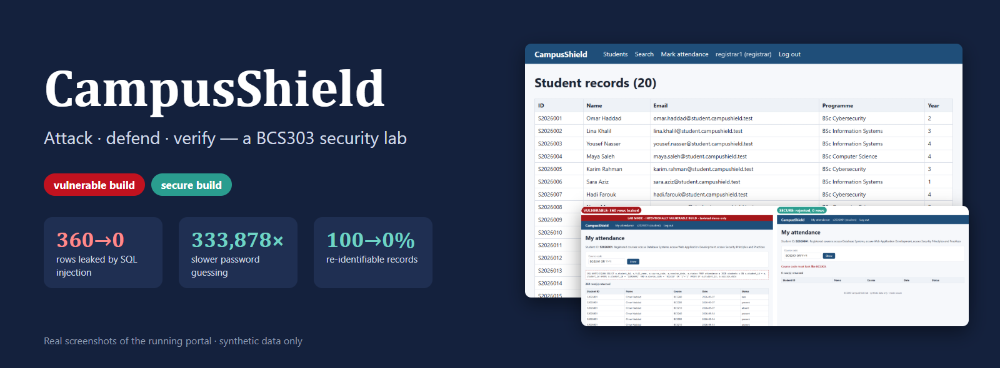

</div>

## Overview

CampusShield is a Flask + SQLite portal for a fictional university with three roles
(administrator, registrar, student) and **synthetic data only**. The portal runs in two builds:

- **secure** (default) - parameterised SQL, auto-escaped output, security headers, RBAC, PBKDF2 passwords, lockout;
- **vulnerable** (lab only) - the same app with a SQL injection and a reflected XSS put back in, so every attack can be shown *before* and *after* the fix.

Every exercise follows the same loop: **baseline → validate the weakness safely → apply a control → repeat the same test → measure the change.**
All outputs in [`evidence/`](evidence) were written by the scripts while they ran.

## Features and security controls

| Area | What is implemented | Where |
|---|---|---|
| Access control | RBAC decorator on every route; student ID taken from the session; separation of duties (admin cannot read records) | [`app/web.py`](app/web.py) |
| Authentication | PBKDF2-HMAC-SHA256 (600k iterations, 16-byte random salt), 12+ char policy, 5-try / 15-min lockout, generic error messages, CSRF tokens, HttpOnly + SameSite cookie | [`app/security.py`](app/security.py) |
| Injection | Parameterised queries + allow-list validation (vulnerable build: string concatenation) | `/attendance` |
| Web output | Jinja2 auto-escaping, CSP, X-Frame-Options, nosniff, Referrer-Policy (vulnerable build: `Markup(q)`, no headers) | `/search` |
| Cryptography | AES-256-GCM CSV encryption with tamper test, SHA-256 integrity check, OpenSSL equivalents, Caesar cipher, LSB steganography | [`demonstrations/`](demonstrations) |
| Network | Nmap before/after, safe validation, service removal, iptables allow-list, HTTP vs HTTPS capture | [`kali/`](kali) |
| Operating system | Service account, groups, 640/750 permissions, authorised vs unauthorised access tests | [`kali/run_kali_lab.sh`](kali/run_kali_lab.sh) |
| Monitoring | Brute-force and password-spray detector for app and sshd logs | [`monitoring/`](monitoring) |
| Privacy | Suppression, HMAC pseudonyms, generalisation, k-anonymity before/after | [`privacy/`](privacy) |
| Phishing | Offline spoofed `.eml` and an analyser (SPF/DKIM/DMARC, lookalike domains, link mismatch) | [`demonstrations/email_simulation/`](demonstrations/email_simulation) |

## Architecture

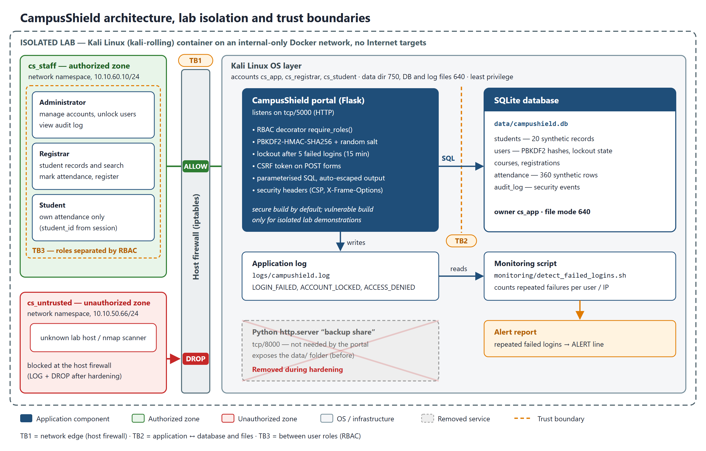

## Application screenshots

| Sign in | Administrator - accounts and lockout |
|---|---|
| 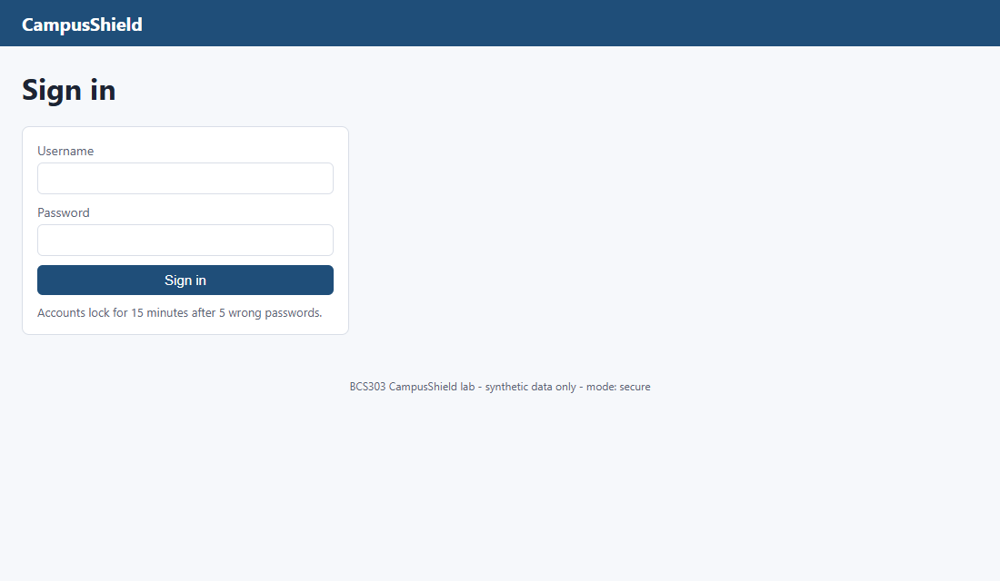 | 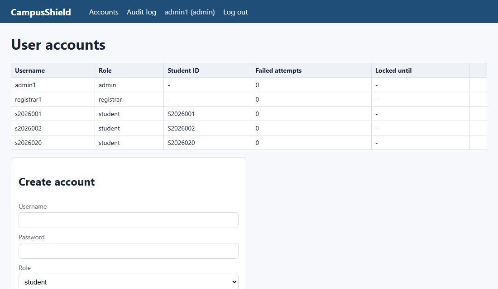 |
| **Registrar - student records** | **Student - own attendance only** |
| 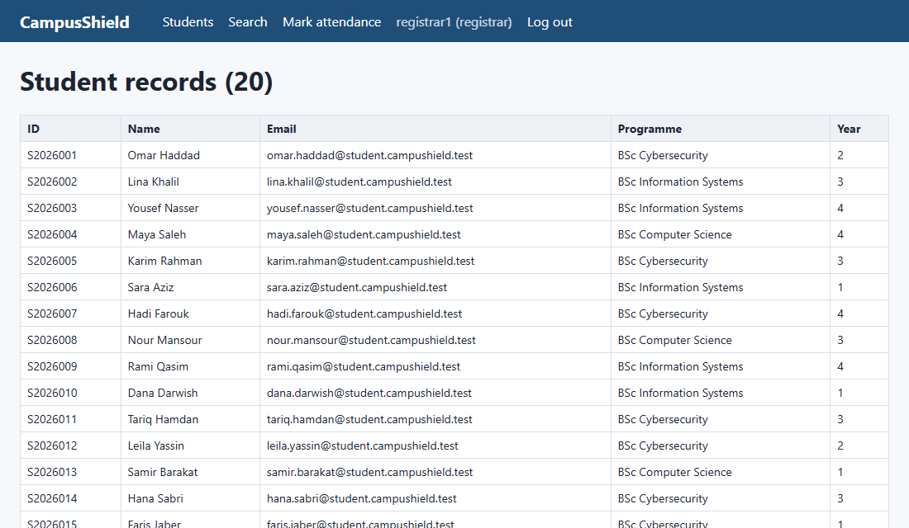 | 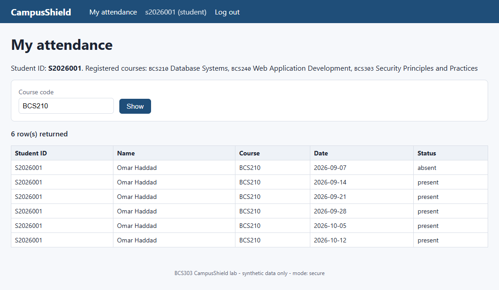 |

## Animated demonstrations

**1. Application walkthrough** - registrar, student (including an RBAC 403) and administrator views

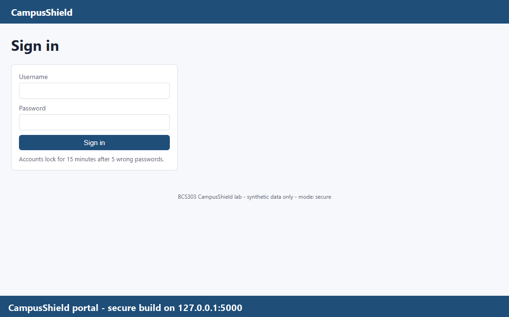

**2. SQL injection** - the same student input against the vulnerable and the secure build

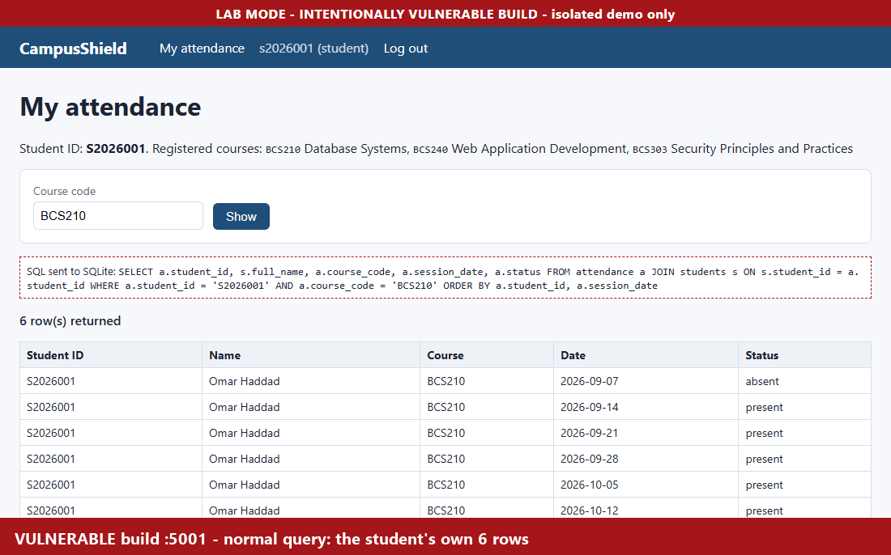

**3. Reflected XSS** - the same crafted link against both builds

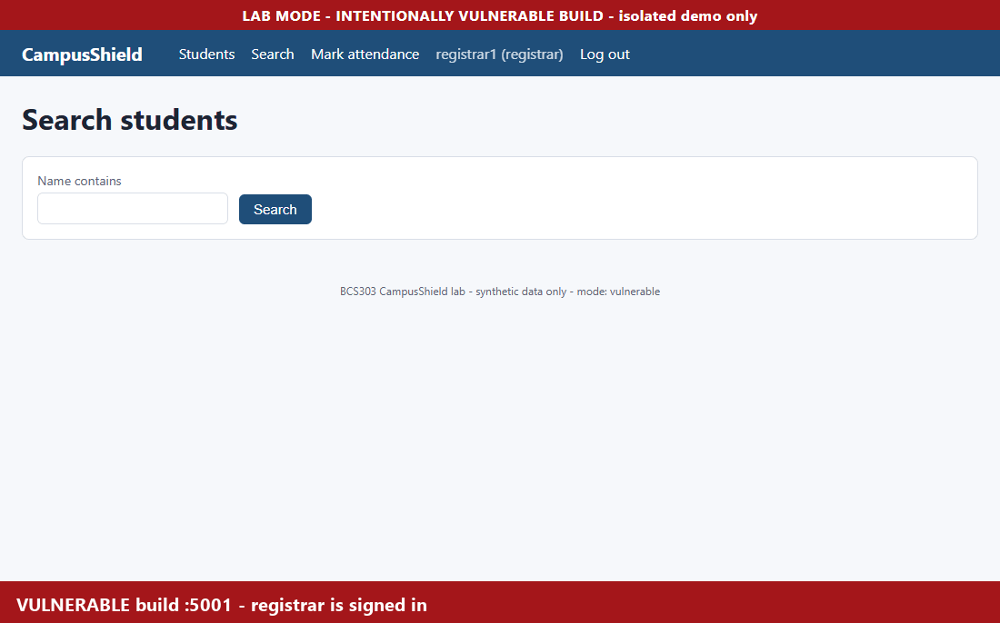

## Before / after results

### Application

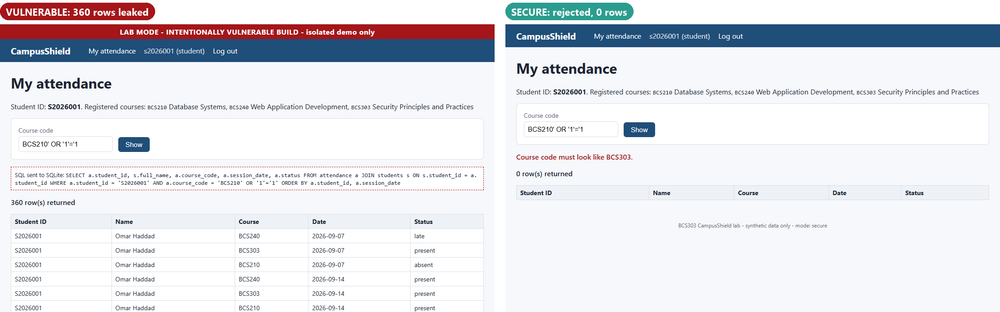

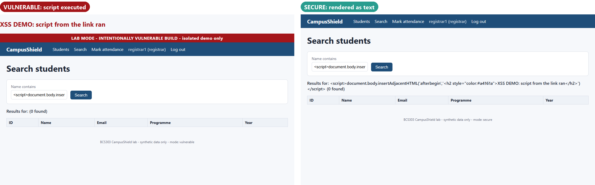

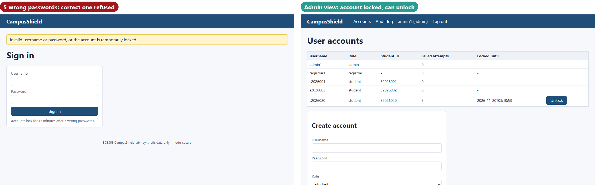

### Network (real Kali run)

Kali Linux (kali-rolling) with Nmap 7.99 and TShark 4.6.9, in a container on an internal-only Docker
network with no published ports. The scanner sits in an "untrusted" network namespace
(10.10.50.66), the registrar workstation in a "staff" namespace (10.10.60.10). Full output: [`evidence/kali/`](evidence/kali).

| Same Nmap command | TCP 5000 portal | TCP 8000 backup share | other ports |
|---|---|---|---|
| Before, from untrusted zone | open - Werkzeug 3.1.9 (vulnerable build) | open - directory listing exposing `campushield.db` | 65,533 closed |
| After, from untrusted zone | filtered | filtered (service removed) | filtered |
| After, from staff zone | open - secure build | filtered | filtered |

| Nmap before hardening | Nmap after hardening |
|---|---|
| 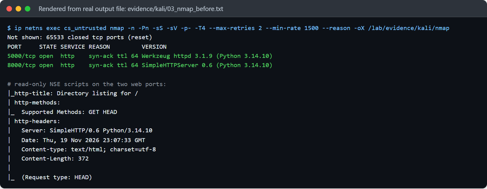 | 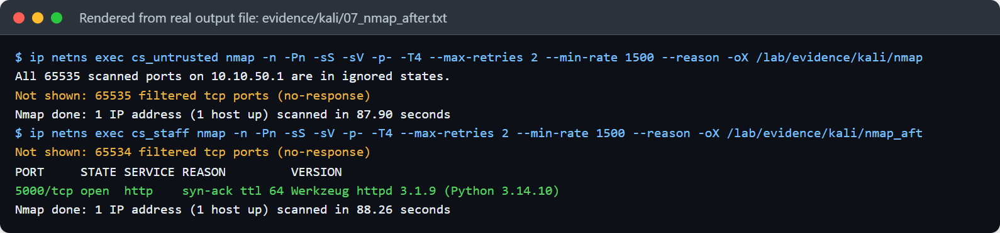 |

| Firewall: allowed / blocked, removed / re-applied | Linux users, groups and permissions |
|---|---|
| 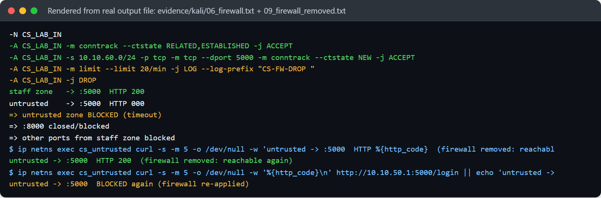 | 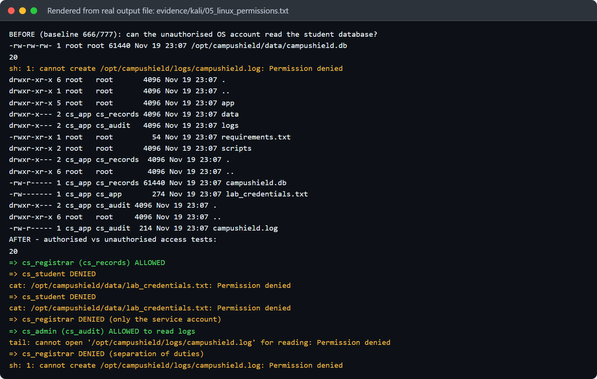 |

| Traffic capture: HTTP form readable vs TLS 1.3 only | Monitoring: brute-force alert from the Kali run |
|---|---|
| 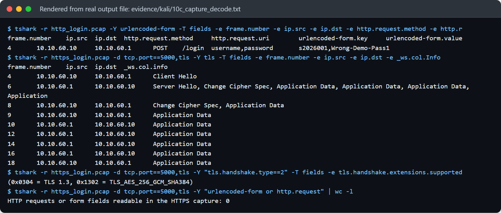 | 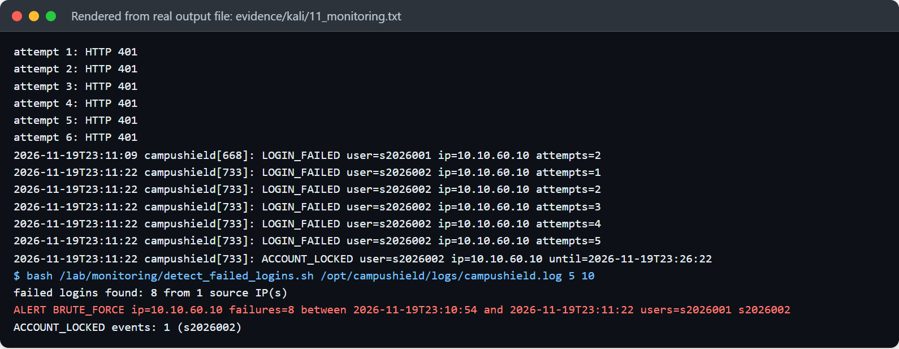 |

<sub>Terminal images are renderings of the saved output files named in their title bars, not live screen captures.
The SQL injection that returned 360 rows from the untrusted zone before hardening was re-tested from the staff zone afterwards: 0 rows, normal query still 6 rows.</sub>


### Scorecard

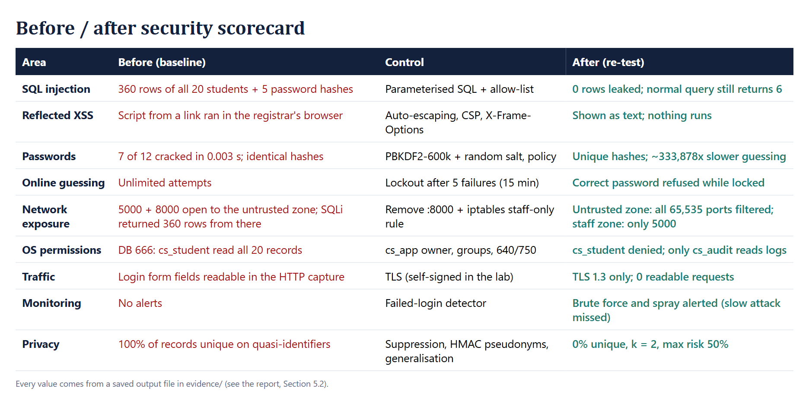

## Course learning outcomes covered

| CLO | Evidence in this repository |
|---|---|
| **CLO-1** Policies, models, mechanisms | Architecture and trust boundaries, asset and threat register, account/record policy, RBAC (report §3.1) |
| **CLO-2** Network threats and vulnerabilities | Nmap full-port scans before/after, safe validation, attack-surface table, exposure reduction ([`evidence/kali`](evidence/kali)) |
| **CLO-3** Authentication and cryptography | Password audit, salted PBKDF2, CSV + AES-GCM + SHA-256, Caesar, steganography ([`evidence/cryptography`](evidence/cryptography), [`evidence/authentication`](evidence/authentication)) |
| **CLO-4** Software, web, database evaluation | SQL injection and XSS before/after, RBAC matrix, phishing simulation, network re-test ([`evidence/sql_injection`](evidence/sql_injection), [`evidence/web_security`](evidence/web_security)) |
| **CLO-5** OS, privacy and cloud practice | Linux permissions, firewall applied/removed, traffic capture, monitoring, k-anonymity, cloud design ([`evidence/privacy`](evidence/privacy), [`evidence/monitoring`](evidence/monitoring)) |

The full requirement-by-requirement checklist is in [`docs/PROGRESS.md`](docs/PROGRESS.md).

## Technology stack

Python 3.12 · Flask 3.1 · SQLite · `cryptography` (AES-GCM) · `hashlib` (PBKDF2, SHA-256) · OpenSSL 3.5 ·
Pillow · Playwright + Microsoft Edge (browser tests and media) · Kali Linux (kali-rolling) with Nmap 7.99,
TShark 4.6, iptables and network namespaces · Docker (isolated Kali lab container) · python-docx + Word (report) ·
pptxgenjs (slides).

## Installation and running

```bash
pip install -r requirements.txt
python scripts/init_db.py                                  # synthetic DB + random lab passwords in data/lab_credentials.txt (git-ignored)
python scripts/run_app.py                                  # secure build      -> http://127.0.0.1:5000
python scripts/run_app.py --mode vulnerable --port 5001    # vulnerable build  -> http://127.0.0.1:5001 (lab only)
```

Accounts: `admin1`, `registrar1`, `s2026001`, `s2026002`, `s2026020`. Passwords are random per install
and only stored in the git-ignored `data/lab_credentials.txt`. The vulnerable build refuses to listen on
anything except loopback unless `--allow-lab-exposure` is given (used only inside the isolated lab).

## Demo instructions

| Demo | Steps |
|---|---|
| SQL injection | As `s2026001` on :5001 enter `BCS210' OR '1'='1` → 360 rows of all students. Same input on :5000 → rejected, 0 rows; `BCS210` still works. |
| Reflected XSS | As `registrar1` open `/search?q=<script>…</script>` on :5001 → script runs. Same link on :5000 → shown as text. |
| Lockout / RBAC | 5 wrong passwords for `s2026002`, then the right one → refused; `admin1` → Accounts → Unlock. A student opening `/students` → 403. |
| Kali network lab | `bash kali/docker/run_lab_container.sh` (or `sudo bash kali/run_kali_lab.sh` in a Kali VM) → `evidence/kali/` |
| Scripted re-runs | `python demonstrations/sql_injection/run_sqli_demo.py`, `python demonstrations/web_security/run_xss_demo.py`, see report Appendix B |

The speaker split and the live demo script are in [`presentation/speaker_script.md`](presentation/speaker_script.md).

## Report and presentation

| Document | File |
|---|---|
| Final report (PDF) | [`report/CampusShield_Final_Report.pdf`](report/CampusShield_Final_Report.pdf) |
| Final report (editable DOCX) | [`report/CampusShield_Final_Report.docx`](report/CampusShield_Final_Report.docx) |
| Slides (PPTX, with speaker notes) | [`presentation/CampusShield_Presentation.pptx`](presentation/CampusShield_Presentation.pptx) |
| Submission bundle | [`submission/`](submission) |

Rebuild: `python report/build_report.py`, `node presentation/build_deck.js`, `python scripts/make_submission.py`,
media: `python scripts/make_media.py all`.

## Safety and scope

Synthetic data only (`.test` e-mail domains). Testing targets were 127.0.0.1 and two network namespaces
inside a Kali Linux container on an internal-only Docker network with no published ports. Nothing on the
Internet or any third-party system was scanned. The phishing e-mail was never sent.

## Project team

| Name | Student ID |
|---|---|
| Zuhair Halawa | 20230002902 |
| Ilyass Elmoussaoui | 20240005481 |

Instructors: Dr. Mehak Khurana & Mr. Ahmed Seyam
